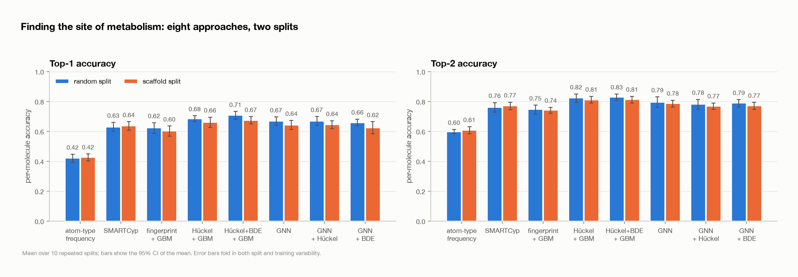
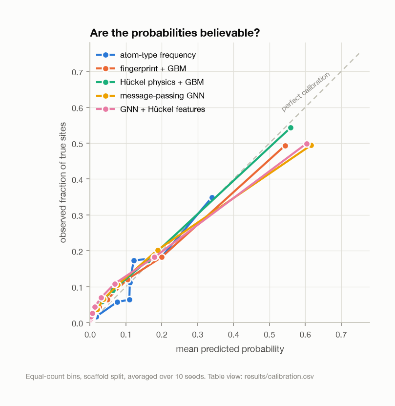
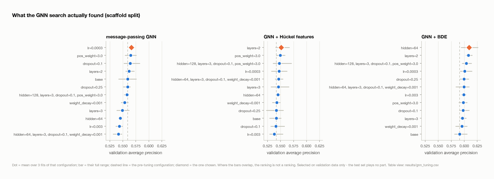
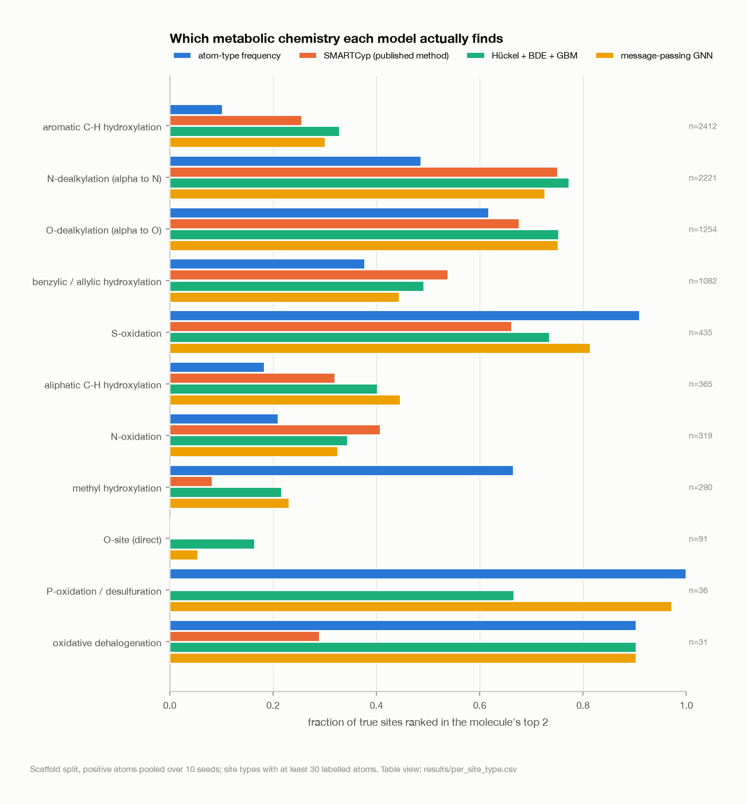
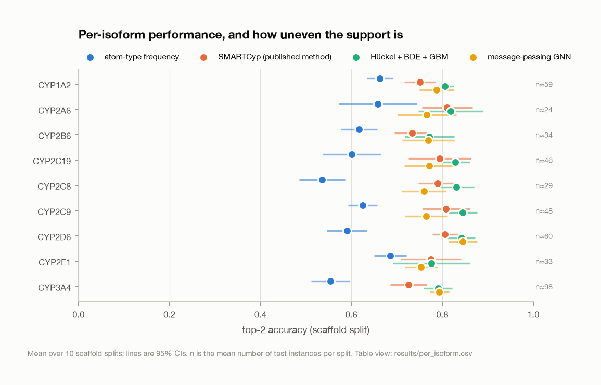
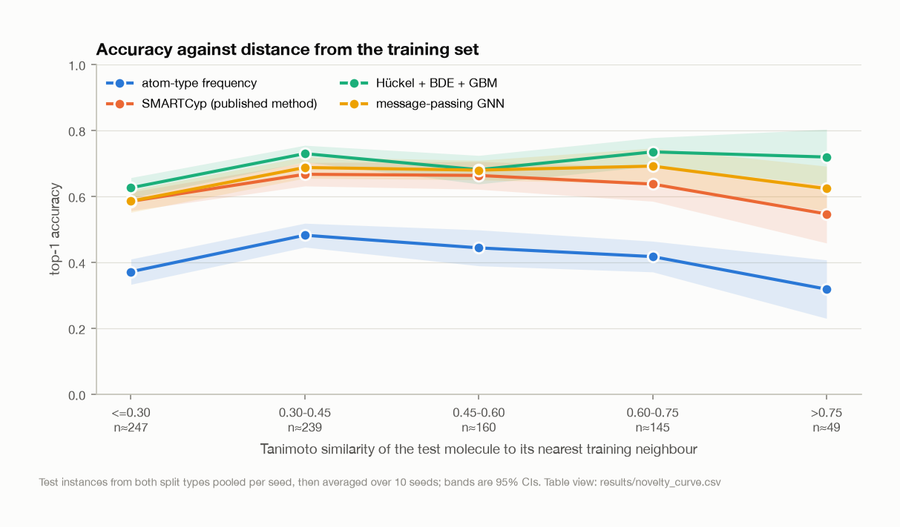

# Where does cytochrome P450 attack this molecule?

Atom-level prediction of cytochrome P450 sites of metabolism, built to be
evaluated honestly rather than to produce a large headline number.

For a given molecule and a given CYP isoform, every heavy atom is a candidate
and the task is to rank them so the atoms that actually get oxidised come out on
top. It is the computational question behind "which position do I block to stop
this compound being cleared", and it is a genuinely atom-level problem: the
answer is a position, not a molecular property.

Eight approaches are compared on the same splits, with the same metrics — two
reference points and six models:

| | what it uses |
|---|---|
| **atom-type frequency** | nothing but the element, H count, aromaticity and ring membership. A reference point, not a model. |
| **SMARTCyp** | the published external method (Rydberg & Olsen): DFT activation energies looked up by SMARTS atom type, plus a 2D accessibility term. Uses no training data at all. |
| **fingerprint + GBM** | hashed circular atom environments (Morgan, radii 0–2) with gradient boosting. |
| **Hückel physics + GBM** | ~60 interpretable descriptors: simple-Hückel frontier densities and Coulson free valence, Gasteiger charges, E-state indices, Crippen contributions, valence/ring context. |
| **Hückel + BDE + GBM** | the above plus ALFABET-predicted C–H bond dissociation energies — DFT knowledge transferred from ~290k calculations. |
| **message-passing GNN** | the molecular graph, learning its own representation from basic atom and bond features. |
| **GNN + Hückel features** | the same network handed the physics descriptors as extra node features. |
| **GNN + BDE** | the same network handed the bond dissociation energies. |

The last two are ablations: they separate "what information is available" from
"which model class can use it".

The frequency reference is there on purpose. "Top-1 of 0.65" means very little
until you know that guessing by atom type alone already gets a good way there,
and most of the interesting information in this project is in the gaps between
the four rows rather than in any one of them.

---

## Results

See [results/summary.md](results/summary.md) — generated by `make report`, not
transcribed by hand — for the full tables, and [results/](results/) for the raw
CSVs behind every figure.

All numbers are means over **10 repeated splits**, with the 95% CI of the mean.
The scaffold split is the one to read first.

| approach | top-1 | top-2 | ROC-AUC | avg precision | ECE |
|---|---|---|---|---|---|
| atom-type frequency | 0.425 [0.402, 0.448] | 0.607 [0.583, 0.631] | 0.802 [0.790, 0.814] | 0.274 | 0.025 |
| SMARTCyp (external, untrained) | 0.635 [0.607, 0.663] | 0.770 [0.744, 0.795] | 0.826 [0.812, 0.840] | 0.341 | 0.018 |
| fingerprint + GBM | 0.601 [0.568, 0.635] | 0.741 [0.721, 0.760] | 0.871 [0.865, 0.878] | 0.499 | 0.018 |
| Hückel physics + GBM | 0.660 [0.626, 0.695] | 0.811 [0.787, 0.834] | 0.887 [0.876, 0.899] | 0.531 | 0.019 |
| **Hückel + BDE + GBM** | **0.674 [0.650, 0.698]** | **0.812 [0.789, 0.834]** | **0.907 [0.899, 0.915]** | **0.584** | 0.019 |
| message-passing GNN (tuned) | 0.643 [0.615, 0.670] | 0.788 [0.771, 0.804] | 0.880 [0.869, 0.891] | 0.504 | 0.026 |
| GNN + Hückel features (tuned) | 0.640 [0.617, 0.663] | 0.770 [0.746, 0.794] | 0.868 [0.861, 0.875] | 0.487 | 0.028 |
| GNN + BDE (tuned) | 0.623 [0.587, 0.658] | 0.778 [0.751, 0.805] | 0.882 [0.872, 0.891] | 0.521 | 0.026 |



Because every model sees the same splits, differences can be **paired**, which
is much more sensitive than eyeballing overlapping intervals. Full tables in
[results/summary.md](results/summary.md); the ones that matter are below.

**SMARTCyp, which does no learning at all, beats two of the six models.** At
0.635 top-1 it is ahead of the fingerprint GBM (0.601) and of GNN + BDE
(0.623), and level with the tuned GNN (0.643), using nothing but tabulated DFT activation energies and a SMARTS match
— no training data touched. The best model here beats it by +0.058 top-1
[+0.036, +0.080], which is real but not large. Anyone presenting a trained SOM
model without this comparison is omitting the number that matters most.

Its ROC-AUC tells a different story though: 0.826 against 0.907. SMARTCyp
assigns many atoms the same "will not react" sentinel, so it ranks well *within*
a molecule — which is what top-k measures and what a chemist wants — but ranks
poorly across the whole atom pool. A good illustration of why this project
reports both.

**The physics descriptors beat the hashed fingerprint, clearly.** Paired over 20
splits, Hückel + GBM gains +0.061 top-1 [+0.045, +0.076] and +0.073 top-2 over
fingerprint + GBM, both p < 0.0001. About 60 interpretable descriptors beat 1024
hashed bits.

**Transferred DFT bond dissociation energies help the GBM.** ALFABET predicts
C–H BDEs at ~0.6 kcal/mol against DFT in milliseconds, having been trained on
~290k dissociations. Adding them:

| phys_bde_gbm − phys_gbm | difference [95% CI] | p |
|---|---|---|
| top-1 | +0.018 [+0.006, +0.030] | 0.005 |
| top-2 | +0.004 [−0.005, +0.012] | 0.40 |
| ROC-AUC | +0.017 [+0.013, +0.022] | <0.0001 |
| avg precision | +0.048 [+0.038, +0.058] | <0.0001 |

A modest top-1 gain and a solid one in atom-level ranking. This is the one
addition that brought in information from outside the dataset, and it is the
only feature set that improved on the Hückel descriptors.

**But extra node features make the GNN *worse*, not better — and that is the
most informative result here.** Giving the GNN the identical feature set
`phys_gbm` uses, with both sides independently tuned:

| gnn_huckel − gnn | difference [95% CI] | p |
|---|---|---|
| top-1 | −0.006 [−0.019, +0.007] | 0.32 |
| top-2 | −0.014 [−0.027, −0.002] | 0.030 |
| ROC-AUC | −0.010 [−0.016, −0.005] | 0.0009 |
| avg precision | −0.016 [−0.028, −0.003] | 0.016 |

Three of four metrics are *negative*, and the two ranking metrics clearly so.
The transferred BDEs do the same thing — `gnn_bde − gnn` is −0.025 top-1
[−0.039, −0.011], p = 0.001 — even though those same features clearly helped
the GBM.

So the earlier reading, that the physics and the learned representation carry
the same information, was too kind. Twenty-one extra node features, which a
boosted-tree model turns into its best result, cost this GNN about a point of
top-2 and a point of AUC.

**On the mechanism, I was wrong once and have corrected it.** This section used
to say the cause was capacity against sample size — a wider input giving the
network more ways to fit the training set. That is the natural explanation and
it is not what the data show. Training both variants for a fixed 60 epochs on
one scaffold split:

| scaffold split, seed 0, epoch 60 | GNN | GNN + Hückel |
|---|---|---|
| train avg precision | 0.885 | 0.902 |
| test avg precision | 0.540 | 0.558 |
| best validation score | 0.5755 (ep 51) | 0.5707 (ep 53) |

Both overfit enormously — train 0.89 against test 0.55, a gap of ~0.34 for a
400k-parameter model on 679 molecules — but they overfit *equally*. At matched
epochs the wider input fits the training data slightly better, not worse, and
the best validation scores differ by 0.005. Extra features are not adding
overfitting.

What does differ is the stability of the validation signal: across epochs the
plain GNN reads 0.537, 0.551, 0.546, 0.555, 0.553, while the Hückel variant
reads 0.543, 0.504, 0.529, 0.560, 0.526. Training stops after 20 epochs without
improvement and restores the best epoch, so a noisier signal gets a worse
checkpoint — sometimes dramatically, since an early lucky spike can roll the
model back forty epochs. The likeliest mechanism for the measured deficit is
therefore **unstable checkpoint selection on a noisier validation signal**,
which is a property of my stopping rule as much as of the features.

The measured difference stands — it is a paired result over 20 splits. The
explanation for it does not, and the diagnostic above is one split, so it
cannot overturn the measurement either. What it does rule out is the tidy
story. Fixing the checkpoint selection is now the most promising GNN change,
and it is listed below.

This now rests on a tuned comparison rather than a default one — each variant
got its own search, described [below](#the-gnn-hyperparameter-search), so it is
not an artifact of the plain GNN having been luckier with its hyperparameters.

**Which means the Hückel model's advantage is not about chemistry at all — it is
about model class.** On *identical* features, gradient boosting beats the GNN:

| phys_gbm − gnn_huckel | difference [95% CI] | p |
|---|---|---|
| top-1 | +0.016 [−0.001, +0.032] | 0.057 |
| top-2 | +0.038 [+0.025, +0.051] | <0.0001 |
| ROC-AUC | +0.019 [+0.014, +0.023] | <0.0001 |
| avg precision | +0.043 [+0.032, +0.054] | <0.0001 |

Same inputs, same splits, same labels; the only difference is the estimator. At
679 molecules a boosted-tree ensemble fits this problem better than a
422k-parameter graph network. The honest headline is therefore **not** "physics
beats deep learning" — it is that at this data scale the tabular model is the
better estimator, and the hand-built descriptors are a cheap, interpretable,
and apparently sufficient way to hand it the relevant structure.

The GNN is no longer under-tuned relative to the GBMs — that caveat has been
discharged, and discharging it did not change the ordering. What remains is the
data-limited caveat: nothing here says this ordering would survive at 10,000
molecules.

The descriptors are also readable, which the GNN's are not. A logistic
regression on the same features (fitted only to be read, never used for
predictions — `results/phys_linear_coefficients_scaffold.csv`) puts
`huckel_free_valence` among its largest positive terms, and
`nbr_max_huckel_free_valence` just behind it, which is the neighbour
propagation doing exactly the job it was added for: flagging benzylic and
allylic carbons that have no π system of their own but sit next to one. The
coefficient on the fragment's HOMO eigenvalue is negative, and since
E = α + xβ with β negative, a smaller x means a *higher-lying* HOMO — so the
model has recovered, unprompted, that an electron-rich π system is more
vulnerable to an electrophilic iron–oxo oxidant. These are standardised
coefficients over correlated descriptors, so they are worth reading
directionally and not as effect sizes.

**A quarter of the top-1 performance is available from atom type alone.** The
frequency reference reaches 0.425 top-1 and 0.607 top-2 knowing nothing but
element, hydrogen count, aromaticity and ring membership. Paired, the best model
adds +0.250 top-1 over it, and even SMARTCyp adds +0.210 [+0.185, +0.235]. Large,
unambiguous gains — and the correct denominator: a paper reporting 0.67 without
this row is reporting something much less impressive than it sounds.

**The scaffold split costs little, but not nothing — and this is one claim the
GNN tuning changed.**

| approach | random | scaffold | gap [95% CI] |
|---|---|---|---|
| atom-type frequency | 0.419 | 0.425 | −0.006 [−0.037, +0.025] |
| SMARTCyp (untrained) | 0.629 | 0.635 | −0.006 [−0.042, +0.030] |
| fingerprint + GBM | 0.622 | 0.601 | +0.021 [−0.022, +0.063] |
| Hückel physics + GBM | 0.684 | 0.660 | +0.024 [−0.011, +0.058] |
| **Hückel + BDE + GBM** | 0.706 | 0.674 | **+0.032 [+0.001, +0.063]** |
| **message-passing GNN** | 0.682 | 0.643 | **+0.040 [+0.009, +0.070]** |
| **GNN + Hückel features** | 0.673 | 0.640 | **+0.033 [+0.004, +0.062]** |
| GNN + BDE | 0.652 | 0.623 | +0.030 [−0.010, +0.070] |

An earlier version of this README said every interval included zero. That is no
longer true: three of the eight now exclude it, including the best model and the
tuned GNN. The direction was always the same and the magnitude has barely moved
— what changed is that the tuned GNN is better on the random split (0.667 →
0.682) without being better on the scaffold split, which widens its gap into
significance. I am flagging the revision rather than quietly restating it,
because "the scaffold split is free" was the more striking claim and it did not
survive.

Read it as a gradient rather than a threshold. The two models that learn nothing
about context — the frequency reference and SMARTCyp — pay nothing, because
their knowledge is per-atom-type and a new scaffold does not change what a
benzylic carbon is. The models that do learn context pay 2–4 points. The split is
genuinely doing its job (zero shared scaffolds; median nearest-neighbour
Tanimoto drops from 0.49 to 0.34), so the small size of the penalty is still the
interesting part: the task is largely *local*, whether a given carbon is
oxidised depends on its immediate electronic and steric environment, and those
environments recur across scaffolds. Holding out a scaffold removes the molecule
but mostly not the chemistry. For atom-level endpoints a scaffold split is a
weaker test of generalisation than it is for whole-molecule endpoints — but it
is not a free one.

**Probabilities are reasonably trustworthy**, with ECE between 0.018 and 0.028
and mild overconfidence in the highest bin — the top-bin atoms are predicted at
0.55–0.62 and come true about 0.49–0.54 of the time. Isotonic recalibration on
the validation split changes little, which is the good case.



### The GNN hyperparameter search

The GNN was the only model running a single fixed configuration, and two
conclusions above depend on it underperforming, so it needed a real search
before those conclusions could be trusted. Twelve configurations per variant —
width, depth, learning rate, dropout, weight decay and positive-class weight —
selected on validation average precision, with each GNN variant searched
independently so the ablations compare equally-tuned models. Every trial is in
[results/gnn_tuning.csv](results/gnn_tuning.csv).

**The search found nothing.** Across 24 paired before/after comparisons (three
variants × two splits × four metrics) the chosen configurations are
indistinguishable from the configuration they replaced:

| | top-1 before → after | difference | p |
|---|---|---|---|
| GNN, scaffold | 0.642 → 0.643 | +0.001 [−0.018, +0.020] | 0.91 |
| GNN + Hückel, scaffold | 0.644 → 0.640 | −0.004 [−0.019, +0.010] | 0.50 |
| GNN + BDE, scaffold | 0.623 → 0.623 | −0.001 [−0.028, +0.027] | 0.95 |

Two of the 24 reach nominal significance, both of them the plain GNN on the
random split (top-1 +0.016, p = 0.046; ROC-AUC +0.010, p = 0.020). Two in 24 is
what 24 tests produce by chance, so I am not claiming them.



This is a negative result worth more than a positive one would have been: the
GNN's weakness is not a tuning artifact, so "at this data size the boosted trees
are the better estimator" stands on a fair comparison.

**Why the measurement needed fixing first.** A single GNN fit turned out to be a
noisy estimate of a configuration's quality, for an uninteresting reason:
`index_add_` accumulating messages across several CPU threads sums in a
nondeterministic order, and that rounding difference compounds through training.
Repeated fits of the *same* configuration at the *same* seed differed by 0.013
validation AP — **larger than the genuine seed-to-seed spread of 0.009**, and
the same size as the gaps between neighbouring grid points. A conventional
one-fit-per-configuration search would have been selecting partly on thread
scheduling.

Two changes followed. The GNN is now pinned to one thread, which makes a fit
bit-exact and costs almost nothing: these graphs are small enough that threading
barely helps, measured at 2.00 s/epoch on one thread against 1.86 s on eight and
1.53 s on two — eight is *slower* than two, because thread overhead dominates
the small matrix multiplies. And each configuration is fitted three times and
scored on the mean, with the spread recorded.

That spread is why the result reads as "found nothing" rather than "found
something". The winning configuration beat the pre-tuning default by +0.007
(plain GNN), +0.009 (+Hückel) and +0.018 (+BDE) validation AP, against a
per-configuration spread of ±0.013–0.014. **Every winner's margin sits inside
the noise.** With one fit per configuration I would have reported a search that
found a real improvement, and been wrong. The figure above plots those ranges
for exactly this reason: where they overlap, the ranking of configurations is
not a ranking.

One consequence to state: the search picked a *different* configuration from the
default in all six cases (lower learning rate for the plain GNN, two layers for
the Hückel variant, narrower or regularized for the BDE variant), so the null
result is not "it re-chose the default". Different configurations, same
performance.

### Where it fails

This is the part worth more than the headline number.



**The learned models lose to the lookup table on exactly the chemistry you would
expect them to find easiest.** On sulfur oxidation the frequency reference
ranks 0.91 of true sites in the top 2 and every learned model does *worse*
(0.69–0.75). Same story for methyl hydroxylation (0.67 reference versus
0.19–0.24) and phosphorus (1.00 versus 0.67–0.92). The mechanism is
straightforward once seen: a molecule usually contains one sulfur, roughly half
of all sulfurs in this set are sites, so "always rank the sulfur first" is a very
strong rule. The learned models reason contextually, sometimes rank an activated
carbon above the sulfur, and pay for it. A blunt element prior beats contextual
reasoning on the cases where context is not needed — a good argument for an
ensemble, and a reminder that aggregate metrics hide this entirely.

**SMARTCyp's failures are different failures, which is what makes it useful
here.** It only scores carbon, nitrogen and sulfur, so oxidative dehalogenation
(0.29 against 0.90 for everything else) and direct oxygen sites (0.00) are
structurally out of reach for it, and methyl hydroxylation collapses to 0.08
against the frequency reference's 0.67. But it is the best of all four on
benzylic/allylic hydroxylation and competitive on N-dealkylation. The errors are
not nested, which is the standard precondition for an ensemble being worth
more than its parts.

**Aromatic C–H hydroxylation is the dominant failure by volume.** It is the
largest site class (2412 labelled atoms) and no model exceeds 0.36 — the best
is Hückel + GBM at 0.358, and the BDE features do not help here (0.329).
A benzene ring offers several near-equivalent positions, the
true one is often decided by sterics or by how the substrate sits in the active
site, and nothing in a 2D model can see that. Aromatic carbons bearing a
substituent (n=22) are never found by anything.

**Per-isoform, the spread is modest but the ordering is informative.**



The best model runs from 0.77 (CYP2B6) to 0.85 (CYP2C9) top-2, and CYP3A4 sits
near the bottom at 0.79 despite having by far the most training data (475
instances, against 151 for 2B6). Its substrates are simply bigger — 25 heavy
atoms on average against 19.7 for CYP1A2 — so there are more candidate atoms to
rank, and 3A4's promiscuity means the chemistry is less sharply determined.
More data does not help when the task itself is harder. The isoform ordering
is not stable across models, though, so read this as "the spread is modest and
3A4 is not the easy case its sample size suggests" rather than as a ranking.

**Performance does decay with novelty, but only at the far end.**



Pooling both split types and bucketing test molecules by similarity to their
nearest training neighbour, top-1 for the best model is 0.63 for molecules below
Tanimoto 0.30 and 0.68–0.73 everywhere above it. So the penalty is real but
confined to genuinely dissimilar chemistry, and it is under 0.10 rather than a
collapse. This is also the more useful form of the random-versus-scaffold
question: the gap between the two split policies is small because both produce
test sets that are mostly *not* in the hard bucket.

---

## What this project is careful about

Four things decide whether a site-of-metabolism number means anything. Each is
handled explicitly, and each has tests.

### 1. The labels are atom indices, and standardization moves atoms

The upstream annotations are 1-indexed heavy-atom numbers. Salt stripping
deletes atoms and canonical SMILES output reorders them, so a naive pipeline can
shift every label onto a neighbouring atom and still train a model that looks
fine. Atoms are tagged with their original index before standardization, the
mapping is recovered afterwards, labels are re-expressed as positions in the
canonical SMILES order, and a round-trip assertion guards every record.

The mapping is then checked against chemistry that is not in doubt, which is
much stronger evidence than any assertion about indices:

| | labelled | all atoms | enrichment |
|---|---|---|---|
| S | 219 | 437 | **5.0×** |
| P | 25 | 52 | **4.8×** |
| C | 3701 | 32595 | 1.1× |
| N | 161 | 3248 | 0.50× |
| O | 46 | 4344 | **0.11×** |
| F | 1 | 551 | **0.02×** |

Sulfur and phosphorus are strongly enriched (S-oxidation and phosphorothioate
desulfuration are classic CYP reactions), fluorine is essentially never a site
(C–F is not cleaved), and oxygen is depleted because O-dealkylation is annotated
at the carbon rather than at the oxygen. 96% of labelled carbons carry at least
one hydrogen, as hydrogen abstraction requires. This pattern is not reproducible
from a mis-indexed dataset.

### 2. One molecule must not appear on both sides of a split

Each molecule appears in up to nine isoform-specific instances, so splitting on
instances would put identical structures in train and test with a different
isoform label attached. Every split here partitions **molecules**, and a test
asserts that no molecule straddles the boundary.

### 3. A scaffold split should be repeatable, and should actually separate chemistry

The usual "Bemis–Murcko split" assigns the largest scaffold groups to training
deterministically, giving exactly one arbitrary partition and no way to put an
error bar on it. Here the scaffold *groups* are shuffled per seed, so the
constraint holds and the split still varies. Acyclic molecules, which have no
Bemis–Murcko scaffold, are each treated as their own group instead of being
lumped into one.

The split is then measured rather than assumed. Nearest-neighbour Tanimoto
similarity from each test molecule to the training set says how much harder the
scaffold split really is — if the nearest training neighbour were still at
Tanimoto 0.8, nothing would have been separated.

### 4. Ties, and the unit of resampling

Symmetry-equivalent atoms frequently receive identical scores. Breaking ties in
index order quietly flatters a model whose first atoms happen to be the labelled
ones, so ties are broken by a seeded random permutation, and a **pessimistic**
variant (a tie counts as a miss) is reported alongside so the size of the effect
is visible.

Bootstrap resampling is over **molecules**, not atoms and not instances: atoms
within a molecule are strongly dependent and instances of one molecule share a
structure, so resampling either would give intervals that are far too narrow.
The headline intervals come from the across-seed spread, which folds in both
split and training variability; the molecule-level bootstrap within each split is
reported separately in `results/metrics_per_run.csv`.

### What is kept out of the test set

Hyperparameters are chosen on the validation split of the **first seed only**,
per model and per split type, and reused for every later seed. The validation
set is carved out of the training molecules under the same grouping rule, so no
test scaffold is ever seen during tuning or early stopping. Isotonic
recalibration is fitted on validation and applied to test; raw and recalibrated
numbers are both reported, since the raw ones say how well calibrated the model
is out of the box.

---

## Data

The Zaretzki CYP substrate set: 2003 molecule–isoform records over 679 unique
molecules and nine human CYP isoforms, with experimentally annotated sites of
metabolism at atom resolution.

**No data is committed to this repository.** `make data` downloads it from a
pinned upstream commit. The reason is a licence subtlety worth stating: the
upstream redistribution is MIT-licensed, but the original measurements were
published as ACS journal supporting information, which is not open-licensed by
default. The MIT grant covers that repository's distribution of the files; it
does not retroactively open the underlying compilation. Shipping code only and
citing the primary sources sidesteps the question entirely.

[DATA.md](DATA.md) has the full provenance, the pinned commit, the per-isoform
counts, and the citations. Anyone intending to redistribute the data itself, or
to use it commercially, should go back to the original publishers.

### Curation

Standardization is RDKit `Cleanup` → largest fragment → uncharge, with the
label tracking described above. Every excluded record is written to
`data/processed/exclusions.csv` with a reason, so nothing disappears silently.

As it turns out **nothing is excluded**: all 2003 records parse, standardize and
keep their labels. 680 upstream IDs collapse to 679 unique structures, because
of an upstream typo pair (`pheanthrene` / `phenanthrene`) that denotes the same
molecule — they share no isoform, so no labels needed merging. 390 Bemis–Murcko
scaffolds plus 45 acyclic molecules. 41,878 candidate atoms, of which 9.94% are
labelled sites.

Positives are the union of the `PRIMARY_SOM`, `SECONDARY_SOM` and
`TERTIARY_SOM` annotations, which is the usual convention for this set.
`--primary-only` reruns the whole pipeline against primary annotations alone
(6.81% positives) as a sensitivity analysis.

---

## Reproducing

```bash
mamba env create -f environment.yml
conda activate som-bench
pip install -e .
```

One command per stage:

```bash
make data        # download the raw SDFs from the pinned upstream commit
```

```bash
make curate      # standardize, relabel, deduplicate; print the curation report
```

Two stages need extra setup and are optional — skip them and the corresponding
models simply aren't run. ALFABET needs its own environment (it pins
`scikit-learn==0.24.2` and needs TensorFlow; see `environment-alfabet.yml` for
why `--no-deps` is correct):

```bash
mamba env create -f environment-alfabet.yml && conda run -n alfabet-env pip install --no-deps alfabet==0.4.1
```

```bash
make bde         # ALFABET C-H bond dissociation energies (~5 s for all 679)
```

SMARTCyp is a Java program under LGPL-3.0 and is not redistributed here. Build
it from the CDK port, then point the stage at the jar:

```bash
git clone https://github.com/cdk/smartcyp && (cd smartcyp && mvn -B -DskipTests package)
```

```bash
make smartcyp SMARTCYP_JAR=smartcyp/target/smartcyp.jar
```

```bash
make evaluate    # all models x both splits x 10 seeds
```

```bash
make analyse     # failure analysis from the saved predictions
```

```bash
make figures     # figures from the result tables
```

```bash
make report      # render results/summary.md
```

Or everything at once:

```bash
make all
```

The tests are worth running first — they cover the Hückel solver against
textbook π systems, the label-tracking chemistry checks, the split guarantees
and the metric edge cases:

```bash
make test
```

`make evaluate` takes roughly 4 hours on a laptop CPU with `JOBS=4`, most of it
in the GNN hyperparameter search (135 fits) and the GNN's 60 trainings. Use
`make evaluate SEEDS=3` for a quick pass.

`JOBS` sets the worker count for the GNN search only. Because every GNN fit is
single-threaded and independent of the others, this changes wall-clock time and
nothing else — the chosen configuration and every reported number are identical
at any value, which is checked rather than assumed. `JOBS=1` keeps everything in
one process. The search is the one stage that parallelises; the per-seed
trainings are still serial.

---

## Implementation notes

**The GNN is deliberately single-threaded** (`som.models._GNN_THREADS`). Running
`index_add_` over several CPU threads accumulates messages in a nondeterministic
order, which made repeated fits of one configuration differ by more than the
differences the hyperparameter search was trying to measure. One thread is
bit-exact and costs ~16% wall time on graphs this small, and it is what makes
the search parallelisable across processes instead of threads. The reasoning and
the measurements are in that module's comments and in
[the search section](#the-gnn-hyperparameter-search).

**Simple Hückel from scratch** (`src/som/huckel.py`). One p orbital per
conjugated atom, heteroatoms via the standard Streitwieser h/k parameters,
energies as E = α + xβ. Two details that are easy to get wrong and are tested:

- *Degenerate frontier orbitals.* In benzene the HOMO is doubly degenerate and
  each individual eigenvector has an arbitrary, uneven distribution; only the
  average over the degenerate pair restores the six-fold symmetry. Frontier
  densities are averaged over all orbitals at the frontier energy.
- *Disconnected π systems.* Diphenylmethane's Hückel matrix is block-diagonal,
  and a global HOMO localised on one ring would leave the other ring with zero
  frontier density. Each connected π fragment is solved separately, with the
  fragment's own frontier eigenvalues reported alongside so a model can still
  learn which fragment is the reactive one.

The tests check it reproduces ethylene, benzene, butadiene bond orders and free
valences, the allyl cation/anion electron counts and the allyl node, pyridine
versus pyrrole nitrogen, and naphthalene's known α-over-β preference.

**[docs/HUCKEL_DESCRIPTORS.md](docs/HUCKEL_DESCRIPTORS.md)** is the reference
for the descriptor set: all 21 Hückel-derived feature columns with what each
one means chemically, the Streitwieser h/k parameters as actually used, and
why the neighbour-aggregated block exists. It is kept in step with the code by
`tests/test_huckel_docs.py`, which fails if a descriptor is renamed, added or
removed without the document following.

Because sp³ carbons have no π system of their own, Hückel quantities are also
aggregated over each atom's heavy neighbours. That is the point: a benzylic
carbon is not conjugated, but it sits next to something that is, and that is
exactly where hydrogen abstraction is easy.

**The GNN** is plain PyTorch — message passing with edge features, residual
connections and layer norm, an isoform embedding added to the initial node
states, and early stopping on validation average precision. No PyTorch
Geometric, which keeps the pinned environment small and portable. 34 node
features, 7 edge features, an isoform embedding added to the initial node
states, 4 message-passing layers at width 128 with residual connections and
layer norm, 422k parameters, early stopping on validation average precision.

The base `gnn` is given only basic atom and bond features, deliberately *not*
the Hückel descriptors, so that "learned representation" and "hand-built
physics" are compared rather than one quietly containing the other.
`gnn_huckel` is the same network with the physics descriptors appended to the
node features (55 instead of 34), which makes its input identical to what
`phys_gbm` receives. A test asserts that the physics feature set is exactly the
graph feature set plus the Hückel block, so the ablation really does isolate
the physics and nothing else.

---

## Limits

Stated plainly, because they bound what these numbers support:

- **One dataset, one source.** Everything here is the Zaretzki set. Its
  annotations come from heterogeneous primary literature, its coverage is
  uneven across isoforms (3A4 has 475 instances, 2A6 has 105), and it is old
  enough to be chemically unrepresentative of current drug-like space. Results
  do not transfer to a new chemotype just because the scaffold split was passed.
- **Absent labels are not negatives.** An atom is labelled a site if someone
  reported it. Unlabelled atoms are a mixture of genuine non-sites and sites
  nobody looked for, so atom-level AUC and average precision are optimistic by
  an unknown amount. Per-molecule top-k is less exposed to this, which is part
  of why it is the headline metric.
- **2D only, no protein.** No conformers, no docking, no isoform structure.
  Isoform identity enters as a one-hot feature or an embedding, so the models
  learn isoform-specific *preferences* over atom environments, not binding.
  Regioselectivity that is determined by how a substrate sits in the active site
  is out of reach by construction.
- **No external test set.** Every number is an internal held-out estimate under
  a particular split policy. SMARTCyp gives an external *method* to measure
  against, which is a real improvement, but a prospective comparison on an
  external *dataset* — against FAME3 or XenoSite too — is still the honest next
  step and is not done here.
- **The SMARTCyp build is the CDK 2.0 port**, whose authors state it "has not
  been tested yet" against the original. It also needs `-Xss512m` to avoid a
  stack overflow in CDK's aromatic bond-order perception, and one fused
  polycyclic molecule fails even then (logged in
  `data/interim/smartcyp_failed.txt`; its atoms score as unreactive, costing
  SMARTCyp at most 1/679 of its top-k). So treat its numbers as a close
  approximation to published SMARTCyp, not as a verified reproduction.
- **The BDE features are predictions, not calculations.** ALFABET is accurate
  to ~0.6 kcal/mol against its own DFT level, and 18 of 679 molecules fall
  outside its stated applicability domain (flagged as a feature column). A real
  DFT or UMA calculation on these molecules would be the stronger version.
- **Modest scale.** 679 molecules is small. The GNN in particular is
  data-limited rather than architecture-limited — a twelve-point search moved it
  nowhere, and it reaches 0.89 train average precision against 0.55 on test —
  and the fact that it does not beat ~60 hand-built descriptors should be read
  that way rather than as a claim about graph networks.
- **The GNN's early stopping is not robust.** It selects a single best epoch
  from a validation signal that swings by ±0.03 between neighbouring epochs. I
  found this while checking a claim rather than by design, it plausibly drives
  the feature-ablation deficits, and it is not fixed here.
- **The Hückel parameters for P and Se are rough analogues**, not fitted values,
  and are flagged as such in the code.
- **The hyperparameter searches are coarse.** Four configurations for the
  gradient boosting models, twelve for each GNN variant. The GNN grid is a set
  of one-at-a-time moves away from a sensible default plus two combinations, not
  a factorial or a Bayesian search, and I deliberately left out the
  upward-capacity moves (`hidden=256`, `layers=6`) to afford three repeats per
  configuration. So "the search found no improvement" is a claim about this
  search, not a proof that no better configuration exists. Given that the
  twelve points explored include the axes most likely to matter at this sample
  size, and that none separated from the default by more than the noise, I would
  be surprised by a large gain — but a wider search is the honest way to settle
  it.
- **The before/after tuning comparison conflates two changes.** The pre-tuning
  numbers were produced multithreaded and so were not exactly reproducible; the
  tuned numbers are single-threaded. Both configurations were chosen without
  touching the test set, so the comparison is sound as "old pipeline against new
  pipeline", but it is not a pure hyperparameter effect.
- **The random-split searches used a shortlist.** Each variant got a full
  twelve-point search on the scaffold split and then only the top three of those
  on the random split, to keep the cost to ~2 h. One side effect: the
  pre-tuning default was not among the top three for any variant, so it was
  never re-evaluated on the random split.

## What I would do next

In rough order of what would most change the conclusions:

1. **An external test set**, and comparisons against FAME3 and XenoSite
   alongside SMARTCyp. This is now clearly the top item: every number here is
   an internal estimate, and SMARTCyp gives an external method but not an
   external dataset.
2. **3D steric accessibility from UMA-optimised geometries.** The single
   largest failure class, aromatic C–H hydroxylation at 0.36, is one where the
   candidate positions are near-electronically-equivalent and sterics decide.
   No electronic descriptor, Hückel or DFT, can separate them; this is the one
   remaining idea that attacks that failure directly.
3. **Treating unlabelled atoms as positive-unlabelled** rather than as
   negatives.
4. **An ensemble of the frequency reference with a learned model**, given how
   badly the learned models lose on sulfur and methyl sites.
5. **Stable checkpoint selection for the GNN.** The learning curves above show
   validation average precision swinging by ±0.03 between neighbouring epochs,
   and early stopping restores a single best epoch from that noisy signal.
   Selecting on a smoothed or averaged score — or averaging weights over the
   last few epochs — is cheap, and it is the most likely explanation for the
   small deficit the feature ablations measure. This should be tried before any
   further conclusion is drawn from `gnn_huckel − gnn`.
6. **A GNN trained on more data than this.** Not a wider search on these 679
   molecules — that was tried and moved nothing. The informative experiment is
   pre-training on a larger metabolism or reactivity corpus and fine-tuning
   here, which tests the data-limited explanation directly instead of assuming
   it.

Three items that used to be on this list — the GNN-with-Hückel ablation, the
SMARTCyp baseline, and a proper GNN hyperparameter search — are now done. The
first two changed the conclusions; the third confirmed one, which is the less
exciting outcome and the more useful one. Real DFT single points for ALIE and
condensed Fukui functions remain untried; given that transferred BDEs helped the
GBM and actively hurt the GNN, the expected value is moderate and the cost is a
cluster run.

---

## Citing the data

The dataset is not mine. If you use it, cite the primary work:

> Zaretzki, J.; Bergeron, C.; Rydberg, P.; Huang, T.-W.; Bennett, K. P.;
> Breneman, C. M. RS-Predictor: A New Tool for Predicting Sites of Cytochrome
> P450-Mediated Metabolism Applied to CYP 3A4. *J. Chem. Inf. Model.* **2012**,
> 52, 1637–1659.

> Zaretzki, J.; Matlock, M.; Swamidass, S. J. XenoSite: Accurately Predicting
> CYP-Mediated Sites of Metabolism with Neural Networks. *J. Chem. Inf. Model.*
> **2013**, 53, 3373–3383.

See [DATA.md](DATA.md) for the redistribution route and the licence position.

## Licence

Code: MIT ([LICENSE](LICENSE)). The licence covers this repository's code only,
not the dataset, which is not distributed here.
